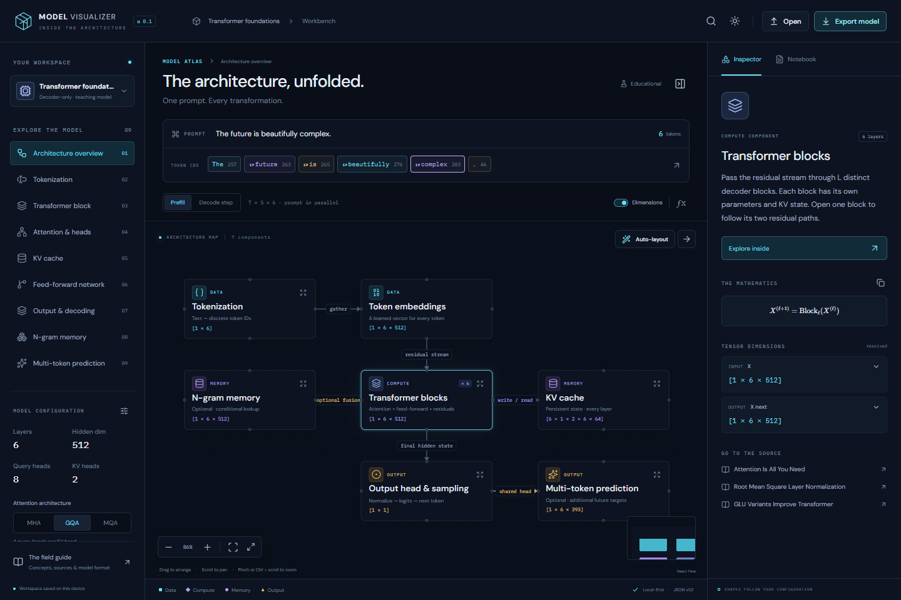
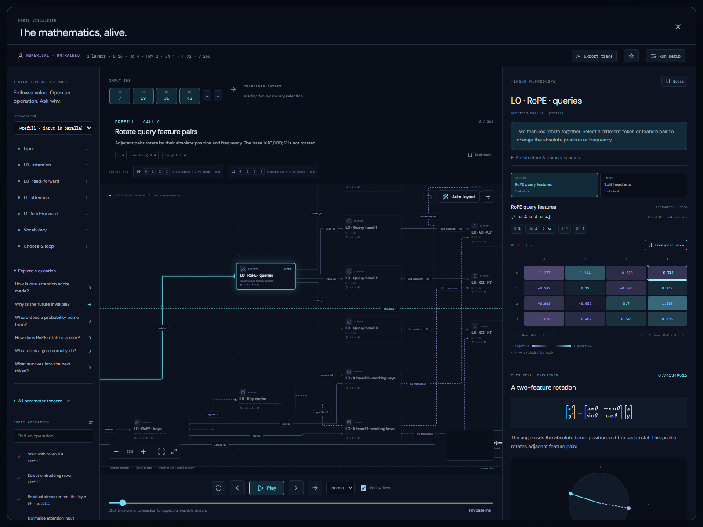

# Model Visualizer

An interactive atlas of language-model architecture, built in TypeScript. Follow a prompt through tokenization, transformer blocks, attention, KV state and output decoding. Inspect the mathematics on a component **or a connection**.



## Run locally

Requires Node.js **24 or newer** and npm. Dependencies are pinned in `package-lock.json`.

```sh
npm ci
npm run dev
```

Open the Local URL printed by Vite. The app runs entirely in the browser, with bundled fonts, equations, research references and the small trained checkpoint. Model assets load on request from the app's own files. There are no API keys, accounts or inference services.

```sh
npm run build       # TypeScript check and production build
npm test            # model contract, tokenizer, maths and layout checks
npm run test:e2e    # Chrome browser tests; needs an installed Chrome
npm run schema     # regenerate the distributable JSON Schema
```

The browser tests launch their own Vite server on port 5200. Set `PLAYWRIGHT_PREVIEW=1` to test the production build instead; build it first. `npm run preview` serves that build for manual inspection. CI installs Chromium and checks routing against both development and production servers; see the workflow.

## Explore

- **Whole model:** one expanded canvas with 252 components and 358 connections in the default teaching configuration. Every main decoder layer, query-head result and KV-head slice appears explicitly, alongside tokenization, feed-forward paths, output and the generation loop. Jump between stages, zoom, drag, auto-layout and save the complete map.
- **Graphical simulation:** abstract packets flow through the model with play/pause, reversible steps, a timeline and camera follow. Switch ordinary decoding or two MTP depths; see proposals, causal verification, accepted prefixes, rejected suffixes, KV rollback and committed output. Text input is not required.
- **Tensor laboratory:** run a small local transformer with seeded, untrained weights. Watch prefill and cached decoding, inspect actual activations, select any matrix cell and follow every product back to its operands. Explore RMSNorm, RoPE rotations, independent attention heads, masks, softmax, SwiGLU and vocabulary selection. Pin experiments for cell comparisons, bookmark operations and save a separate laboratory notebook.
- **Local trained model:** load the bundled Stories260K checkpoint and its matching tokenizer, generate a short completion in a worker, and inspect its real learned weights, attention and activations in the same flowchart and tensor microscope. No inference service, account or GPU is required. Checkpoint hashes and arithmetic provenance are visible, and trained layouts/notes save separately. [Profile and verification](docs/local-trained-model.md).
- **Eleven study views:** the original architecture, tokenizer, transformer block, attention, KV cache, feed-forward, output, n-gram memory and MTP views, plus generation/verification and fully split attention heads.
- **79 authored components:** graph templates and an expansion recipe supply explanations, tensor dimensions, LaTeX and primary sources. Click an edge label to inspect its operation.
- **Real teaching BPE:** edit the prompt; see UTF-8 bytes, token IDs and every ranked merge. Unicode round-trips losslessly.
- **Attention:** split every query head into its own Q → scores → mask → softmax → value path. Switch MHA/GQA/MQA and inspect correct KV sharing. The split whole-model variant has 420 components and 610 connections, with its own saved layout.
- **KV cache:** choose full, sparse (fixed anchors + recent positions), or sliding-window retention. Inspect retained/evicted absolute positions, per-head slices, working versus persistent state, ring-buffer examples and policy-aware bytes. Simulation preserves checkpoints during MTP verification and rollback.
- **Shape the teaching model:** set the model width, then repartition it using either query-head count or features per head. The linked controls maintain `D = Hq × Dh`, even RoPE widths and valid KV sharing. Choose explicit GQA divisors; incompatible partitions and oversized expanded views are excluded. [Builder preview](docs/images/teaching-model-controls.png), [light/mobile preview](docs/images/teaching-model-mobile.png).
- **Layouts:** drag nodes, pan/zoom, fit, or auto-layout horizontally/vertically. ELK compares complete arrangements; large maps pack each section's actual routed footprint into compact bands. libavoid routes orthogonal connections around nodes and labels, with distinct ports and clean straight runs through annotations. Undo restores the previous layout. Every graph remembers its positions and viewport. [Compact whole-model preview](docs/images/whole-model-compact.png).
- **Portable workspaces:** automatic browser-local saves, editable notebook, and readable JSON import/export. Invalid imports leave the current workspace intact.
- **Appearance:** dark and light themes, cyan/violet/amber accents, category text and different legend shapes. No red/green status distinction.
- **Detailed tooltips:** hover a control for 0.7 seconds to read its purpose, constraints and available alternatives. Move between controls to restart the delay; Escape dismisses the explanation. Use the question-mark control in the toolbar or workbench to choose a 0–5 second delay or disable automatic help. Preferences save on this browser, separately from model documents. [Dark](docs/images/detailed-tooltips.png) and [light/mobile](docs/images/detailed-tooltips-mobile.png) previews.

Use `/` to search components. Open the **field guide** for explanations, the research library and a model-format introduction. On narrow screens, the menu opens navigation and the inspector button toggles its overlay.

## What this first version represents

The bundled **Transformer foundations** document is a teaching architecture: six distinct pre-norm decoder layers, RoPE, configurable dense MHA/GQA/MQA and SwiGLU. It is **not a named checkpoint**.

The tokenizer executes an explicit, small byte-BPE vocabulary. Tensor dimensions and logical KV bytes are calculated. Attention heatmaps are deterministic synthetic examples. The graphical simulator uses abstract packets and scripted reference choices; it does **not** compute logits, execute trained weights or generate language. Its renderer-neutral execution trace keeps numerical/local-model adapters possible without coupling them to the canvas. The n-gram path is an illustrative, inactive extension in the simulator. The MTP study view explains auxiliary training; generation and verification are shown separately.

The separate **tensor laboratory** executes a two-layer, width-16 reference model with actual Float32 tensors and JavaScript Number accumulation. Its input/output are opaque vocabulary IDs and its parameters are **untrained**. It computes real logits and attention probabilities, without claiming trained-model activations, meaningful language or GPU-kernel equivalence. MHA/GQA/MQA and full/sparse/sliding cache experiments are supported. Numerical MTP and arbitrary imported model execution are future work; the existing graphical MTP simulator remains available. [Explore the numerical profile, provenance and saving format](docs/numerical-laboratory.md).



The **local trained-model** path runs Karpathy's Stories260K: five width-64 layers, eight query/four KV heads, a 512-token vocabulary and tied embedding/output weights. It captures full causal inference for up to 48 prompt tokens and 16 new IDs, with actual text decoding. It is a small base completion model with limited language quality. Only this pinned trained profile is supported; arbitrary checkpoints and numerical MTP remain future work. [Local model documentation](docs/local-trained-model.md).

MLA, MoE, more advanced sparse patterns, arbitrary tokenizer plugins and external activation-trace import are researched extension points, not completed inference features. The [research map](docs/research.md) distinguishes their semantics and the work needed to add them.

## Model documents and future development

The authored source of truth is [`examples/transformer-foundations.model.json`](examples/transformer-foundations.model.json). It keeps model semantics, tensor expressions, explanations, sources, notebook and layout in one versioned document. The app is a renderer and explorer of that document.

- [Model format and agent authoring instructions](docs/model-format.md)
- [Research map, component taxonomy and primary references](docs/research.md)
- [Software architecture and extension boundaries](docs/architecture.md)
- [Graphical execution and future numerical adapters](docs/simulation.md)
- [Independent attention heads and KV retention policies](docs/attention-and-cache.md)
- [Numerical laboratory, scalar provenance and experiment format](docs/numerical-laboratory.md)
- [Machine-readable JSON Schema](examples/model.schema.json)
- [Repository instructions for future agents](AGENTS.md)

The format is an architectural description, not a general tensor execution engine. Branches and subgraphs are supported; extending runtime mathematics or state representations requires explicit TypeScript support and appropriate validation. Breaking format changes require a version and migration.

## Saving

The last valid workspace saves under `model-visualizer.workspace.v1` in local storage. **Export model** downloads the full pretty-printed `.model.json` file, including every layout and notebook. **Open** validates a replacement before applying it. Browser-local saves are specific to an origin and device; export files provide portable copies.

The project is developed directly on `main`, without pull requests.
