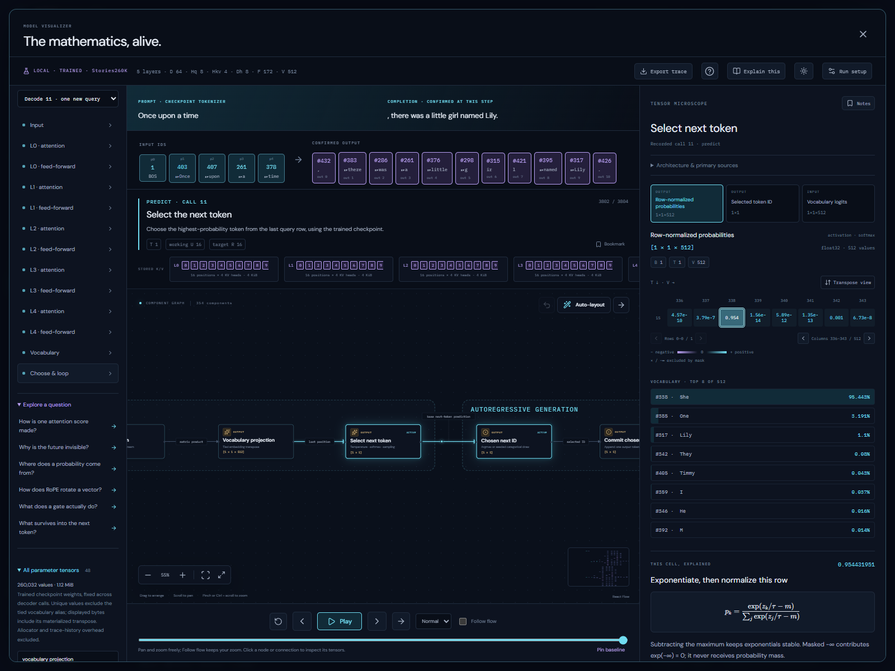

# Local trained-model inspection

Open **Local trained model → Load trained model → Generate & inspect**. The app runs the bundled **Stories260K** checkpoint locally in a Web Worker. Loading and generation require visible button presses. No prompt, weight or activation is sent to an inference service. Once the app assets are available, this path needs no external connection, account, API key, Python or GPU.

Stories260K is Andrej Karpathy's small base completion model trained on TinyStories. It is useful for understanding inference, with limited language quality. It is not an instruction/chat model. See the author's [training recipe and reference samples](https://github.com/karpathy/llama2.c/blob/350e04fe35433e6d2941dce5a1f53308f87058eb/doc/stories260K.md) and [checkpoint repository](https://huggingface.co/karpathy/tinyllamas/tree/0bd21da7698eaf29a0d7de3992de8a46ef624add/stories260K).

## What runs

| Property                          | Checkpoint value                            |
| --------------------------------- | ------------------------------------------- |
| Unique learned parameters         | 260,032                                     |
| Decoder layers                    | 5                                           |
| Residual width D                  | 64                                          |
| Query / KV heads                  | 8 / 4 (GQA)                                 |
| Head width Dh                     | 8                                           |
| SwiGLU intermediate width F       | 172                                         |
| Vocabulary                        | 512                                         |
| Checkpoint context capacity       | 512 positions                               |
| Inspection capture limit          | 48 prompt IDs including BOS, 1–16 new IDs   |
| Attention / retention             | Full causal attention and full KV retention |
| Parameters and activation storage | Float32                                     |

Each layer uses pre-RMSNorm, Q/K/V projections, adjacent-pair RoPE with base 10,000, GQA, an attention residual, a second RMSNorm, SwiGLU and the feed-forward residual. RMSNorm epsilon is 1e-5. The final normalization feeds a vocabulary projection **tied to the embedding transpose**. There are no biases, numerical MTP, n-gram memory or architecture switches. These choices follow the pinned [original implementation](https://github.com/karpathy/llama2.c/blob/350e04fe35433e6d2941dce5a1f53308f87058eb/run.c).

The loader reads the original `llama2.c` v0 binary layout. File linear matrices use output-by-input indexing; the inspector's row-vector convention uses their transposes. This is an exact rearrangement of learned values. The embedding is shared mathematically with the classifier. This reference implementation materializes its transpose; the parameter library excludes that alias from the unique learned count and includes it in materialized payload bytes. Neither these bytes nor the logical KV axes specify a GPU allocator or optimized storage layout.

The matching `tok512.bin` vocabulary contains scored BPE entries and UTF-8 byte fallbacks. Encoding adds BOS, uses the original dummy-space-prefix behavior, and repeatedly merges the highest-scoring adjacent vocabulary pair with the leftmost tie break. It does not use the teaching tokenizer, normalize whitespace or apply a chat template. Input/output pieces, vocabulary candidates and actual IDs appear in the laboratory. BOS/EOS end generation; special IDs are retained in traces but omitted from decoded prose.

## Following a generation

The worker computes a bounded trace of genuine checkpoint inference, with retained K/V between decoder calls. Generated-token progress is reported while it runs. Each recorded operation contains its actual arrays, shapes, semantic axes, absolute positions and calculation recipe. Play/step/scrub replays that captured computation; it does not pause an optimized kernel at every mathematical operation. Confirmed output text follows the selected playback step, and inspecting earlier calls does not present future activations as available.

The same canvas and microscope provide:

- All five layers and eight independent query-head paths, with correct four-head K/V sharing.
- Clickable component outputs, connection payloads and destination operands.
- Tensor slicing, display transpose, cell arithmetic and backward operand navigation.
- Trained embedding/projection/gain inspection, explicit tied-weight provenance, and source links.
- Per-layer absolute-position cache maps and resident logical K/V bytes.
- Greedy or reproducible categorical selection, vocabulary candidates, and confirmed decoded text.
- Dragging, auto-layout, direction changes, layout undo, notes, bookmarks, dark/light themes and narrow-screen panes.

The original untrained laboratory remains independent, including its architectural and retention experiments and pinned comparisons. The trained profile keeps its checkpoint topology fixed; substituting MHA, MQA or a different retention policy would change the executed model.

## Precision and verification

### Controlled head-output experiments

**Run setup → Experiment on a trained head** offers zero ablation or donor activation patching for a selected layer and query head. The intervention replaces only that head's value-weighted vector at the final prompt position, before concatenation and Wo. The engine retains the original computed vector under a separate tensor ID and gives the replacement an explicit intervention recipe. The microscope identifies modified versus unchanged rows and links to the original calculation. Q/K scores and that layer's attention probabilities are not edited; downstream projections, residual additions and later layers are recomputed from the replacement. Checkpoint parameters and ordinary generation remain unchanged.

Both recipient baseline and intervention produce one next-token distribution, regardless of the ordinary generation budget. The donor run uses the same verified checkpoint and its own final prompt position; differing donor lengths are explicitly not a matched-position claim. All runs use the same existing capture limits and reference arithmetic. **Follow differences through the run** shows the first changed cell in execution order, downstream output deltas and a chosen vocabulary ID's final-prompt probability. Max-absolute and RMS differences apply only to compatible shapes, axes and position maps; the 1e-6 threshold is a numerical display threshold, not statistical significance. Later generated-token divergence in ordinary comparisons is distinguished from the initial prompt comparison.

The result supports only the stated replacement, prompt and output metric. It does not establish a feature's semantic identity or general necessity. See [Zhang & Nanda, Towards Best Practices of Activation Patching in Language Models](https://arxiv.org/abs/2309.16042) for why metrics and corruption choices matter. Same-run donor patching is tested as an exact no-op on logits; zero ablation changes only the requested head row before downstream recomputation. Saved investigation recipes can prepare an explicit replay, and trace JSON includes intervention metadata and replacement values. These additions do not change the model-document or checkpoint-study extension version.

The application's TypeScript kernel uses JavaScript Number accumulation and Float32 arrays, rounding each operation output. Its activations are actual results of this reference kernel with trained weights. They need not be bit-identical to upstream C, NumPy/BLAS, BF16, a GPU kernel or a fused implementation; the UI records this arithmetic provenance.

`scripts/reference-stories260k.py` is an optional, independent NumPy FP32 verifier. It reads the original output-by-input matrices and recomputes the complete causal prefix for each output, instead of using the application's retained cache. Its checked-in golden fixture records tokenizer IDs, the last prefill logit row, one head's RoPE query/attention, and a 16-token greedy continuation. Tests compare logits within 1e-4 absolute error, the selected query/attention within 1e-5, and generated IDs exactly. Browser tests use the actual bundled checkpoint and cover asset-load gating, provenance, no external requests, corruption refusal, inspection, exports, workspaces, routing and responsive themes.

## Assets and saving

`examples/stories260k.checkpoint.json` records model identity, architecture, pinned author revision, source links, license, exact file sizes and SHA-256 digests. The original ~1 MiB weights and matching ~6 KiB tokenizer are in `public/models/stories260k/`, with the upstream MIT license. The worker verifies both hashes before inference. An incompatible size, header, non-finite weight or hash produces an error; no random fallback is used.

The optional `model-visualizer.local-checkpoint` extension, version 1, stores checkpoint identity/revision, prompt/sampling settings and separate study geometry, bookmarks and notes. It does not replace the architecture document, main notebook or untrained experiment. Unsupported saved versions or fields are preserved without being overwritten. A reopened workspace requires explicit loading/generation again.

**Export trace** writes the actual trained parameters and arrays, the input prompt/IDs/vocabulary pieces, output, recipes, arithmetic and checkpoint/tokenizer hashes to a separate readable JSON file. Masked negative infinity uses `"-Infinity"`. This can be much larger than the workspace. Trace-file import and arbitrary checkpoints are not implemented.

Adding a larger model needs its own validated manifest, tokenizer, supported architecture, capture/memory limits and numerical reference checks. The checkpoint interface supplies learned parameters to the renderer-independent engine; the worker and shared microscope do not depend on an inference service.
